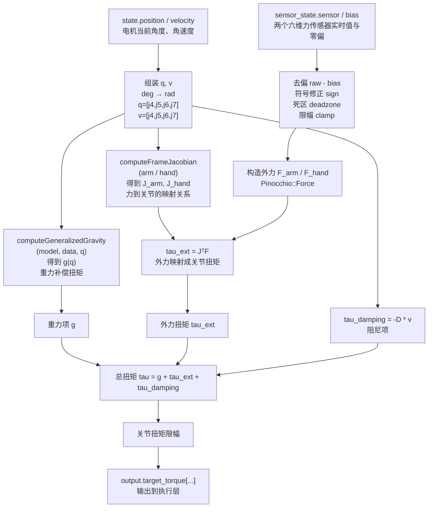

# Zero Force 控制代码解析（Pinocchio 使用流程）

## 1. 概述

该函数实现零力控制（Zero Force Mode），目标是让机械臂在受力时表现为低阻抗状态，使用户可以轻松推动机械臂。

控制核心为：

```c++
tau = g(q) + JᵀF - Dv
```

其中：

- `g(q)`：重力补偿
- `JᵀF`：外力映射到关节扭矩
- `-Dv`：阻尼项

------

# 2. 数据流图（Mermaid）



------

# 3. Pinocchio 使用流程

## 3.1 加载模型（初始化阶段）

```
pinocchio::urdf::buildModel(urdf_path, model);
pinocchio::Data data(model);
```

说明：

- `model`：机器人结构（来自 URDF）
- `data`：计算缓存（每次计算复用）

特点：

- 只初始化一次
- 不随时间变化

------

## 3.2 获取 frame

```
frame_id = model.getFrameId("frame_name");
```

说明：

- 用于定位传感器或末端位置
- 后续 Jacobian 计算需要使用 frame_id

------

## 3.3 构造关节状态 q, v

```
Eigen::VectorXd q(model.nq);
Eigen::VectorXd v(model.nv);
```

作用：

- 创建与模型自由度一致的状态向量

注意：

- `model.nq`：位置维度
- `model.nv`：速度维度

数据来源：

```
q(i) = state.position[...] * DEG2RAD;
v(i) = state.velocity[...] * DEG2RAD;
```

关键点：

- Pinocchio 不保存状态
- 每个周期必须重新赋值 q 和 v

------

## 3.4 重力计算

```
g = pinocchio::computeGeneralizedGravity(model, data, q);
```

输出：

- 每个关节的重力补偿扭矩

作用：

- 抵消机械臂自身重量

------

## 3.5 Jacobian 计算

```
pinocchio::computeFrameJacobian(
    model, data, q, frame_id,
    pinocchio::LOCAL, J);
```

输出：

- `J (6 × nv)` Jacobian 矩阵

作用：

- 建立关节空间与任务空间之间的映射关系

------

# 4. 力处理流程

## 4.1 读取传感器

```
raw - bias
```

说明：

- 消除零偏

------

## 4.2 数据处理

包括：

- 符号修正（方向统一）
- 死区处理（消除噪声）
- 限幅（防异常值）

------

## 4.3 构造空间力

```
pinocchio::Force f;
f.linear()  = [Fx, Fy, Fz];
f.angular() = [Mx, My, Mz];
```

注意：

- 顺序为 `[angular; linear]`（内部存储）

------

# 5. 外力到关节扭矩映射

```
tau_ext = J.transpose() * F;
```

含义：

- 将任务空间力转换为关节扭矩

物理意义：

- 外部作用力如何分配到各个关节

------

# 6. 阻尼项

```
tau_damping = -D * v;
```

作用：

- 抑制震荡
- 防止系统发散
- 提高稳定性

------

# 7. 总控制输出

```
tau = g + tau_ext + tau_damping;
```

组成：

- 重力补偿
- 外力响应
- 阻尼

------

# 8. 限幅与输出

```
tau(i) = clamp(tau(i), limit);
```

作用：

- 防止电机过载

输出：

```
output.target_torque[...] = tau;
output.valid = true;
```

------

# 9. 关键设计思想

## 9.1 Model 不会变化

- URDF 只在初始化加载
- 不随时间更新

## 9.2 q 才是“机器人当前状态”

- 每个周期手动更新
- 决定所有计算结果

## 9.3 Pinocchio 是无状态计算器

- 不存历史
- 每次调用都基于当前 q

------

# 10. 控制逻辑总结

完整流程：

```
读取编码器 → 构造 q, v
读取传感器 → 处理得到 F

Pinocchio:
    g(q)
    J(q)

计算:
    tau_ext = JᵀF
    tau_damping = -Dv

合成:
    tau = g + tau_ext + tau_damping

输出:
    电机扭矩
```

------

# 11. 在外骨骼中的意义

该控制策略实现：

- 重力补偿（减轻负担）
- 力响应（人机交互）
- 稳定性控制（阻尼）

效果：

- 操作轻便
- 响应自然
- 不易震荡

------

# 12. 模板化总结（可复用）

```
// 1. 状态输入
q = get_joint_position();
v = get_joint_velocity();

// 2. 传感器
F = preprocess_sensor();

// 3. Pinocchio
g = computeGeneralizedGravity(model, data, q);
J = computeFrameJacobian(model, data, q);

// 4. 力映射
tau_ext = J.transpose() * F;

// 5. 阻尼
tau_damping = -D * v;

// 6. 合成
tau = g + tau_ext + tau_damping;

// 7. 限幅 + 输出
tau = clamp(tau);
send_to_motor(tau);
```

------